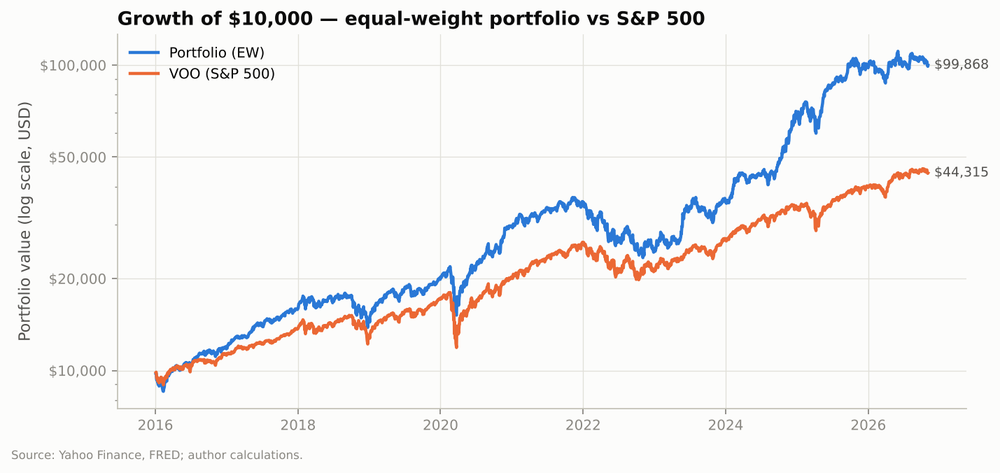

# Quantitative Portfolio Analysis & Machine-Learning Trading Signals

An end-to-end quantitative research project on a real 22-holding portfolio of
stocks and ETFs. It moves from classical time-series analysis (Shumway &
Stoffer, ch. 1–3) through mean-variance optimisation, machine-learning signal
research, risk-managed position sizing and Black-Litterman allocation. Every
result is tested out of sample, and the whole pipeline runs on **free data
only**.

📄 **Full research report: [docs/REPORT.md](docs/REPORT.md)**. It covers each
phase in detail (method, results, interpretation and caveats) with
plain-English explainers.

---

## Headline results

Data: daily prices, Jan 2015 – Nov 2026. The "current" portfolio is equal
weight, rebalanced monthly; real position sizes were not used.

| | Portfolio (equal weight) | S&P 500 (VOO) |
|---|---:|---:|
| Annual return, 2016–2026 | **23.7%** | 14.8% |
| Sharpe ratio | **0.97** | 0.73 |
| Worst drawdown | −36.5% | −34.0% |
| Beta, last 3 years | 1.28 | 1.00 |
| Return, last 12 months (hold-out) | **−4.3%** | **+11.8%** |



## Key findings

1. **The outperformance came with concentration risk.** Three AI and quantum
   names (QBTS, PLTR, NVDA) produced about half of the portfolio's return over
   the last 3 years. In the most recent 12 months, OKLO fell 82% and QBTS 72%.
   QBTS, OKLO and SOLS are 15% of the money but carry about 40% of the risk.
2. **The 18 holdings with 3-year histories behave like fewer than 3
   independent bets.** VOO and VTI are 99.6% correlated.
3. **"Optimal" weights don't survive out of sample.** Max-Sharpe optimisation
   raised the Sharpe ratio from 1.46 to 1.81 in hindsight. Re-optimised
   monthly without hindsight, it lagged equal weight (0.64 vs 0.85).
4. **Simple beats complex.** 12-1 momentum was the only signal with validated
   predictive power (IC 0.045, t-stat 2.2). Ridge, XGBoost, LSTM and an
   ensemble did not beat it. In the untouched hold-out year, no signal worked.
5. **Risk overlays.** Volatility targeting
   plus a drawdown stop cut the worst drawdown from −36.5% to −23.5%, at the
   cost of a lower Sharpe ratio.
6. **Black-Litterman adds no tilt today.** It scales the model's views by the
   model's own recent accuracy, which is currently negative, so the
   allocation stays at its starting weights.

---

## What each phase does

| Phase | Question | Methods |
|---|---|---|
| **1. Buy & hold analysis** | How has the portfolio behaved, and is it diversified? | CAGR, volatility, Sharpe, Sortino, drawdown, beta and alpha vs VOO; correlation and diversification ratio; ADF stationarity tests; ACF/PACF and Ljung-Box tests |
| **2. Portfolio optimisation** | Would different weights have done better, *without hindsight*? | 10,000 Monte Carlo portfolios; SLSQP max-Sharpe and min-volatility; efficient frontier; Ledoit-Wolf covariance shrinkage; monthly rolling out-of-sample backtest |
| **3. Signal research** | Can free data predict which holdings beat the average next week? | 25 features in 7 families; rank-IC analysis with decay and VIX regimes; momentum baseline, AR(p), Ridge, XGBoost, LSTM, ensemble; purged walk-forward validation |
| **4. Risk management** | How should forecasts become position sizes? | Signal tilt; half-Kelly sizing; volatility targeting (EWMA covariance); 20% drawdown stop; explicit trading costs with 0–4× sensitivity |
| **5. Black-Litterman** | How far should we tilt away from a neutral portfolio? | Equilibrium prior (equal weight, or market cap/AUM from Bigdata.com); Grinold-scaled views using the model's trailing realised IC; posterior mean-variance weights |

## Research standards

- **No look-ahead bias.** Features use only data available at each date. The
  walk-forward process purges labels that overlap the future. Two automated
  tests confirm that changing future prices never changes any past prediction.
- **Hold-out discipline.** The final 12 months (from 1 Nov 2025) are never
  used to choose models or parameters. They are reported separately as the
  honest test.
- **Self-improvement loop with a champion/challenger rule.**
  `pipelines/improve.py` tests new model settings on validation data only.
  A challenger replaces the champion only if it beats it by a set margin.
  Every trial is logged, so the number of attempts is visible.
- **Data-quality controls.**
  - Pre-merger SPAC prices are removed: QBTS history starts 8 Aug 2022 and
    OKLO 10 May 2024.
  - Holdings with broken free data (SKYT, PSKY) are excluded and documented.
- **Reproducible.** Fixed random seeds; every assumption lives in
  `src/pa/config.py`; one command rebuilds every table and chart.

---

## Portfolio

| Group | Holdings |
|---|---|
| Speculative tech | QBTS, OKLO, PLTR, SOLS |
| Blue chip | HON, IBM, NVDA, MSFT, META, AMZN |
| Diversified ETFs | VOO, VTI, VEA, VB, VO, VWO, VCIT |
| Sector-specific | QTUM, SKYT\*, JD, WDAY, PSKY\* |

\*Excluded from the analysis: the free price history for these is unusable.

## Data sources

| Source | Data |
|---|---|
| Yahoo Finance (`yfinance`) | Adjusted daily prices and volume, VIX, Treasury yields |
| FRED (St. Louis Fed) | 3-month T-bill (risk-free rate), 10y–2y term spread, Baa credit spread |
| [Bigdata.com](https://bigdata.com) | Point-in-time snapshot: market caps, ETF AUM, analyst targets, EPS surprises, news sentiment |

The original plan used institutional data (WRDS/OptionMetrics, LSEG news,
Bloomberg, Capital IQ). That access ended at graduation, so the signal
research uses price, volume and macro features only.

---

## Getting started

```bash
git clone https://github.com/KAC329/portfolio-analysis.git
cd portfolio-analysis
pip install -r requirements.txt
./run_all.sh --refresh                   # download data, run tests, run all five phases
python pipelines/improve.py --trials 3   # one self-improvement iteration
```

Outputs are written to `results/figures`, `results/tables` and
`results/metrics`.

## Repository structure

```
portfolio-analysis/
├── src/pa/                        # Library
│   ├── config.py                  #   every assumption and parameter
│   ├── data.py                    #   download, cache, data-quality checks
│   ├── metrics.py                 #   performance and risk statistics
│   ├── backtest.py                #   cost-aware backtest engine with drawdown stop
│   ├── optimize.py                #   mean-variance optimisation
│   ├── features.py                #   Phase 3 feature library
│   ├── models.py                  #   models, walk-forward validation, IC scoring
│   ├── risk.py                    #   signal tilt, Kelly, volatility targeting
│   └── bl.py                      #   Black-Litterman
├── pipelines/
│   ├── p1_portfolio_analysis.py   # Phase 1
│   ├── p2_optimization.py         # Phase 2
│   ├── p3_signal_research.py      # Phase 3
│   ├── p4_risk_management.py      # Phase 4
│   ├── p5_black_litterman.py      # Phase 5
│   └── improve.py                 # self-improvement loop (champion/challenger)
├── tests/                         # unit tests, including look-ahead-bias tests
├── data/snapshots/                # Bigdata.com point-in-time snapshot
├── results/{figures,tables,metrics}/
├── docs/REPORT.md                 # full research report
├── run_all.sh
└── requirements.txt
```

## Status

| Component | Status |
|---|---|
| Phases 1–5 | ✅ Complete on real data (Jan 2015 – Nov 2026) |
| Tests | ✅ 13 passing |
| Model improvement loop | 🔄 Ongoing; promotions are logged to `results/metrics/checkins.md` |

Next steps: remove macro features from the cross-sectional models (XGBoost
was using them to fit noise), and add features that stay robust when the
market regime changes.

---

## References

- Shumway, R.H. & Stoffer, D.S. (2017). *Time Series Analysis and Its Applications*. Springer.
- Markowitz, H. (1952). Portfolio Selection. *Journal of Finance*.
- Ledoit, O. & Wolf, M. (2004). A well-conditioned estimator for large-dimensional covariance matrices. *Journal of Multivariate Analysis*.
- DeMiguel, V., Garlappi, L. & Uppal, R. (2009). Optimal versus naive diversification. *Review of Financial Studies*.
- Black, F. & Litterman, R. (1992). Global Portfolio Optimization. *Financial Analysts Journal*.
- Grinold, R. & Kahn, R. (2000). *Active Portfolio Management*. McGraw-Hill.
- López de Prado, M. (2018). *Advances in Financial Machine Learning*. Wiley.
- Chen, T. & Guestrin, C. (2016). XGBoost: A Scalable Tree Boosting System. *KDD*.
- Hochreiter, S. & Schmidhuber, J. (1997). Long Short-Term Memory. *Neural Computation*.

*Educational research, not investment advice. Backtests are hypothetical.*
