# Quantitative Portfolio Analysis — Research Report

| | |
|---|---|
| **Portfolio** | 22 holdings (stocks + ETFs), see §1 |
| **Benchmark** | Vanguard S&P 500 ETF (VOO) |
| **Report status** | 🟢 **All five phases run on real data.** The improvement loop is active (§7) |
| **Last updated** | 2026-11-03 |
| **Data as of** | Prices: 2 Jan 2015 – 3 Nov 2026 (Yahoo Finance, FRED). Snapshot: 3 Nov 2026 (Bigdata.com) |
| **Code** | `run_all.sh` rebuilds every table and chart in this report |

> **How to read this report.** Each phase follows the same layout used in
> professional investment research: **Objective → Method → Results →
> Interpretation → Caveats**. Boxes marked **📘 Concept** explain the finance or
> statistics idea in plain English for readers new to the topic; experienced
> readers can skip them.

---

## Executive summary

**Bottom line.** The portfolio beat the S&P 500 by a wide margin over ten
years, but by taking more market risk and relying on a few AI and quantum
stocks. Those same stocks reversed hard in the most recent 12 months. Of
everything tested, only the classic **12-month momentum** signal showed real
predictive power, and even that faded in the most recent year. None of the
machine-learning models earned its complexity yet.

| | Portfolio (equal weight) | S&P 500 (VOO) |
|---|---:|---:|
| Annual return, Jan 2016 – Nov 2026 | **23.7%** | 14.8% |
| Sharpe ratio, same period | **0.97** | 0.73 |
| Worst drawdown, same period | −36.5% | −34.0% |
| Beta to the S&P 500, last 3 years | 1.28 | 1.00 |
| **Return, last 12 months (hold-out)** | **−4.3%** | **+11.8%** |

**Key findings**

1. **Outperformance came with concentration risk** (§2). Over the last 3
   years, QBTS, PLTR and NVDA supplied about half of the portfolio's return.
   In the latest 12 months, OKLO fell **−82%** and QBTS **−72%**, turning a large
   lead into a 16-point shortfall against the S&P 500.
2. **18 holdings behave like fewer than 3 independent bets** (§2). VOO and VTI
   are 99.6% correlated, effectively the same fund held twice.
3. **"Optimal" weights don't survive real life** (§3). Hindsight optimisation
   raised the Sharpe ratio from 1.46 to 1.81. Re-optimised monthly *without*
   hindsight, it lagged plain equal weight (0.64 vs 0.85) and traded 3× more.
4. **Only momentum predicts, and only modestly** (§4). Holdings that rose most
   over the past year kept beating the average for the next week (IC 0.045,
   t-stat 2.2 on 2018–2025 data). Ridge, XGBoost, LSTM and the ensemble did
   *not* beat this zero-parameter rule. In the untouched hold-out year, every
   signal, including momentum, stopped working.
5. **Risk overlays cut drawdowns but cost more return than they saved**
   (§5). Volatility targeting plus a drawdown stop reduced the worst loss from
   −36.5% to −23.5%, but the Sharpe ratio fell from 0.87 to 0.68. Half-Kelly
   sizing did worst. Trading costs are not the problem: even at 4× the
   assumed costs, results barely change.
6. **Black-Litterman behaves sensibly** (§6). Because momentum's recent
   accuracy is slightly negative, the model adds no tilt today and stays at
   the starting weights. A market-cap starting point would put 74% in NVDA,
   MSFT, AMZN and META.

**Implications (educational, not investment advice)**
- Decide deliberately how much of the portfolio may sit in highly volatile
  names. At equal weight, QBTS, OKLO and SOLS are 15% of the money but carry
  about **40% of total portfolio risk** (QBTS 19%, OKLO 16%, SOLS 5%; last
  12 months).
- Holding both VOO and VTI adds nothing; one is enough.
- Equal weight remains a strong, cheap default. No model here justifies
  replacing it yet; the improvement loop (§7) keeps testing.

### Open items

| # | Item | Owner |
|---|---|---|
| 1 | *(Optional)* Provide real position sizes; the analysis assumes **equal weights** (§1.2) | You |
| 2 | Verify SKYT and PSKY (excluded for broken data, §1.3) | You |
| 3 | Continue the champion/challenger model loop and record check-ins (§7) | Claude (automated) |

---

## 1. Portfolio, data and assumptions

### 1.1 Holdings

| Group | Holdings |
|---|---|
| Speculative tech | QBTS (D-Wave Quantum), OKLO (Oklo), PLTR (Palantir), SOLS (Solstice Advanced Materials) |
| Blue chip | HON, IBM, NVDA, MSFT, META, AMZN |
| Diversified ETFs | VOO (S&P 500), VTI (total US), VEA (developed ex-US), VB (small cap), VO (mid cap), VWO (emerging), VCIT (investment-grade corporate bonds) |
| Sector-specific | QTUM (quantum ETF), SKYT (SkyWater), JD (JD.com), WDAY (Workday), PSKY (Paramount Skydance) |

### 1.2 Key assumptions

| Assumption | Value | Why / effect |
|---|---|---|
| Current weights | **Equal weight** across holdings trading on each date, rebalanced monthly | Real position sizes are unknown. New listings join at the next month-end |
| Risk-free rate | 3-month T-bill (FRED `DGS3MO`) | Standard for Sharpe/Sortino |
| Trading costs (one-way) | ETFs 2 bp · large caps 5 bp · small/speculative 20 bp | Conservative retail estimates. Phase 4 tests 0×–4× these costs |
| Return convention | Daily total return (prices adjusted for splits and dividends); annualised with 252 days | — |
| Hold-out period | 2025-11-01 → today | **Never used to tune any model.** Reported separately as the honest test |

All parameters live in [`src/pa/config.py`](../src/pa/config.py).

> **📘 Concept — why a hold-out period?** If you try 100 model settings and
> keep the best one, part of its "skill" is luck. Setting the last 12 months
> aside, and looking at them only *after* every choice is made, gives an
> unbiased estimate of how the strategy would have done in real life.

### 1.3 Data sources and data quality

| Source | Used for | Access | Status |
|---|---|---|---|
| Yahoo Finance (`yfinance`) | Adjusted daily close & volume; VIX; Treasury yields | Free | ✅ 2 Jan 2015 – 3 Nov 2026 |
| FRED (St. Louis Fed) | T-bill rate, 10y–2y term spread, Baa credit spread | Free, no key | ✅ to 30 Oct 2026 |
| [Bigdata.com](https://bigdata.com) (plugin) | Market caps, ETF AUM, analyst targets, EPS surprises, news sentiment | Plugin | ✅ Snapshot saved: `data/snapshots/bigdata_snapshot_2026-11-03.csv` |

**Snapshot (Bigdata.com, 3 Nov 2026, 17:00 UTC):**

| Ticker | Size (USD) | Price | Mean analyst target | Implied upside | Last EPS surprise | News sentiment | Flag |
|---|---:|---:|---:|---:|---:|---:|---|
| NVDA | 4.87T cap | 208.54 | 339.17 | +62.6% | +6.2% | −0.02 | |
| MSFT | 3.77T cap | 516.22 | 611.74 | +18.5% | +3.6% | −0.21 | |
| AMZN | 2.65T cap | 248.00 | 328.48 | +32.5% | −4.1% | −0.34 | |
| META | 1.34T cap | 621.46 | 834.36 | +34.3% | +13.1% | −0.53 | |
| PLTR | 410B cap | 173.12 | 216.61 | +25.1% | +8.3% | −0.07 | |
| IBM | 239B cap | 250.26 | 271.07 | +8.3% | +3.5% | −0.11 | |
| HON | 70.9B cap | 223.89 | 256.92 | +14.8% | +4.6% | +0.20 | |
| WDAY | 47.7B cap | 198.95 | 201.85 | +1.5% | +5.4% | −0.16 | |
| JD | ≈31.5B cap | HK$107.30 | — | — | +13.0% | +0.02 | Quoted in Hong Kong (9618.HK); market cap converted at 7.78 HKD/USD |
| SOLS | 7.8B cap | 49.25 | — | — | — | +0.15 | ⚠️ Stale price (29 Oct 2025, when-issued ticker) |
| OKLO | 4.38B cap | 23.16 | 63.33 | +173% | −70.9% | +0.02 | |
| QBTS | 3.80B cap | 10.33 | 36.14 | +250% | −18.1% | −0.38 | |
| SKYT | 1.60B cap | 32.46 | 29.00 | −10.7% | — | +0.54 | ⚠️ Stale since 31 Jul 2026; listed as private, so verify |
| PSKY | — | — | — | — | — | — | ⚠️ Not resolved |
| VOO | 1,000B AUM | 694.23 | | | | | |
| VTI | 689B AUM | 371.81 | | | | | |
| VEA | 232B AUM | 69.45 | | | | | |
| VWO | 125B AUM | 55.45 | | | | | |
| VB | 76.9B AUM | 293.87 | | | | | |
| VCIT | 66.6B AUM | 79.14 | | | | | |
| QTUM | 5.06B AUM | 132.71 | | | | | |
| VO | — | — | | | | | ⚠️ ETF data not available |

*Sentiment is Bigdata.com's recent-window news score (−1 to +1). "Implied upside" =
mean analyst target ÷ price − 1. It is a cross-check, not an input to any model.*

**Price-history checks** (full table: `results/tables/p1_data_quality.md`)

| Issue found | Holding | Treatment |
|---|---|---|
| Pre-merger SPAC shell (≈$10 trust value) carried under the new ticker | QBTS (DPCM Capital, from Dec 2020) | History starts **8 Aug 2022**, the first day as D-Wave |
| Same | OKLO (AltC Acquisition, from Jul 2021) | History starts **10 May 2024**. That day's −54% move and 25M-share volume mark the switch |
| Single price only (30 Jul 2026) | SKYT | **Excluded** |
| 15 scattered prices (29 Jul – 16 Oct 2026) | PSKY | **Excluded** |
| Snapshot price stale (when-issued ticker) | SOLS | Yahoo history is complete from 20 Oct 2025, so it is used |
| Bigdata.com ETF data missing | VO | Price history fine; excluded only from the market-cap prior (§6) |

All other holdings have complete histories, with no gaps and no stale runs.
The analysis therefore covers **20 of the 22 holdings**.

---

## 2. Phase 1 — Buy-and-hold analysis

**Objective.** Describe how the current portfolio has behaved in risk and return,
whether it is actually diversified, and what the return series look like
statistically, as a foundation for later modelling.

**Method.**
- Per-holding statistics over each holding's full history, plus a common
  3-year window (fair like-for-like comparison).
- Portfolio = equal weight, monthly rebalance, vs VOO.
- Correlation matrix; diversification ratio; effective number of independent bets.
- Augmented Dickey-Fuller (ADF) test on log prices vs log returns; ACF/PACF
  and Ljung-Box tests (Shumway & Stoffer ch. 1–3).

> **📘 Concept — the risk/return metrics in one place.**
> - **CAGR** (compound annual growth rate): the steady yearly rate that would turn your start value into your end value.
> - **Volatility**: how much returns swing (standard deviation, annualised). About ⅔ of years land within ±1 volatility of the average.
> - **Sharpe ratio**: return above the risk-free rate per unit of volatility. Roughly: < 0.5 weak, ~1 good, > 1.5 rare for long periods.
> - **Sortino ratio**: like Sharpe, but only counts *downside* swings as risk.
> - **Max drawdown**: the worst fall from a previous peak. It tells you what you would have had to sit through.
> - **Beta**: sensitivity to the market. A beta of 1.5 tends to move 1.5% when the S&P moves 1%.
> - **CVaR 95%**: the average loss on the worst 5% of days.

> **📘 Concept — stationarity.** Prices wander (they "remember" where they
> were), so their average and spread change over time. That makes them
> *non-stationary*, and most statistical models give misleading answers on
> them. Returns usually *are* stationary. The ADF test checks this formally
> (p < 0.05 means "stationary"). This is why every model here uses returns.

**Results.**

*Table 2.1 — Portfolio vs benchmark* (equal weight, monthly rebalance, net of costs)

| | Period | CAGR | Volatility | Sharpe | Sortino | Max drawdown | Beta | Alpha (ann.) | Info ratio |
|---|---|---:|---:|---:|---:|---:|---:|---:|---:|
| **Portfolio (EW)** | Jan 2016 – Nov 2026 | **23.7%** | 22.1% | **0.97** | 1.41 | −36.5% | 1.09 | 7.2% | 0.77 |
| VOO (S&P 500) | Jan 2016 – Nov 2026 | 14.8% | 17.7% | 0.73 | 1.03 | −34.0% | 1.00 | — | — |
| **Portfolio (EW)** | last 3 years | **45.2%** | 23.6% | **1.51** | 2.38 | −21.1% | 1.28 | 14.2% | 1.29 |
| VOO (S&P 500) | last 3 years | 22.2% | 14.8% | 1.13 | 1.66 | −18.7% | 1.00 | — | — |

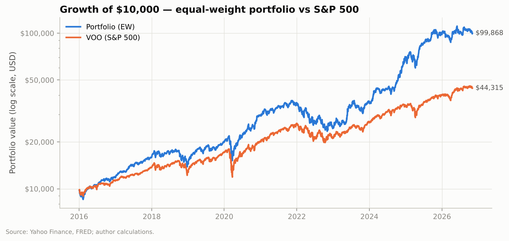
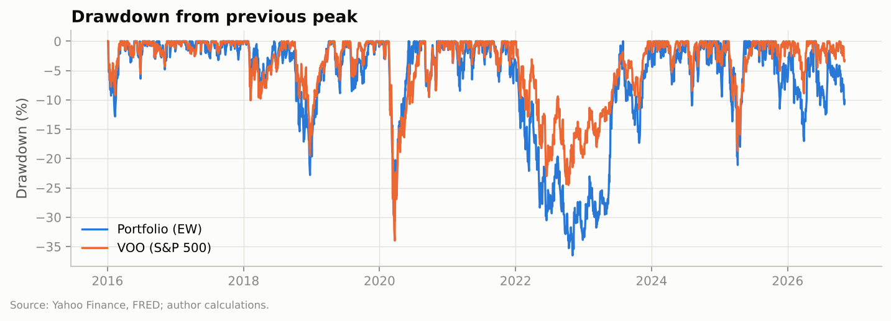

*Table 2.2 — Holdings ranked by Sharpe ratio, last 3 years* (full table incl.
each holding's whole history: `results/tables/p1_asset_stats.md`)

| Holding | CAGR | Volatility | Sharpe | Max drawdown | Beta |
|---|---:|---:|---:|---:|---:|
| PLTR | 114.5% | 64.0% | 1.43 | −48.2% | 2.15 |
| NVDA | 68.8% | 46.7% | 1.26 | −36.9% | 2.12 |
| QTUM | 43.5% | 29.4% | 1.22 | −25.4% | 1.58 |
| QBTS | 120.5% | 132.5% | 1.19 | −77.5% | 2.88 |
| VOO | 22.2% | 14.8% | 1.13 | −18.7% | 1.00 |
| VTI | 22.0% | 15.3% | 1.09 | −19.3% | 1.03 |
| VEA | 20.3% | 15.7% | 0.98 | −13.5% | 0.82 |
| VO | 19.0% | 14.5% | 0.97 | −19.0% | 0.87 |
| VB | 18.7% | 18.6% | 0.78 | −25.4% | 1.07 |
| VWO | 15.9% | 16.5% | 0.71 | −17.4% | 0.78 |
| META | 26.4% | 38.5% | 0.68 | −34.2% | 1.48 |
| AMZN | 22.4% | 31.9% | 0.65 | −30.9% | 1.43 |
| IBM | 23.1% | 35.3% | 0.65 | −37.5% | 0.78 |
| MSFT | 15.4% | 26.2% | 0.51 | −34.5% | 1.02 |
| VCIT | 6.3% | 5.2% | 0.35 | −4.9% | 0.11 |
| HON | 8.9% | 23.1% | 0.30 | −22.1% | 0.73 |
| JD | 4.7% | 43.4% | 0.22 | −44.5% | 0.82 |
| WDAY | −2.3% | 41.7% | 0.05 | −63.4% | 0.81 |

*OKLO (2.5 years since its merger) and SOLS (1 year) are excluded here. Over
their own short histories: OKLO CAGR 50.9%, volatility 117%, worst drawdown
−86.6%; SOLS CAGR 26.9%, volatility 54.7%.*

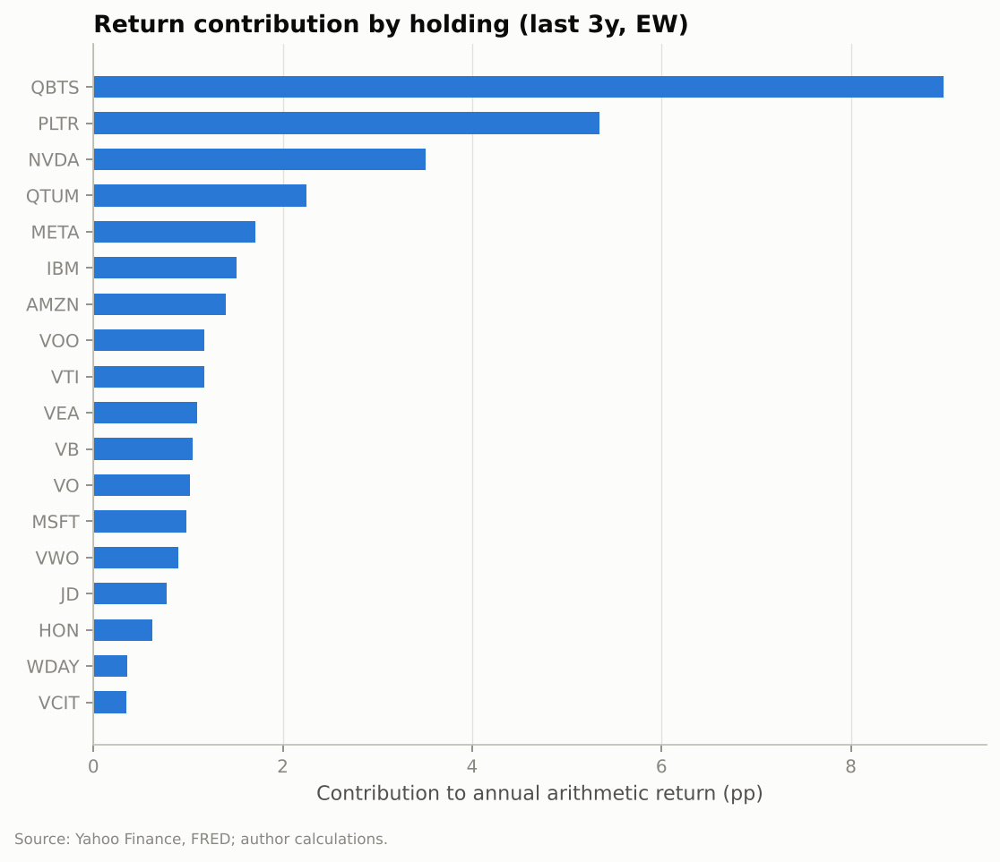
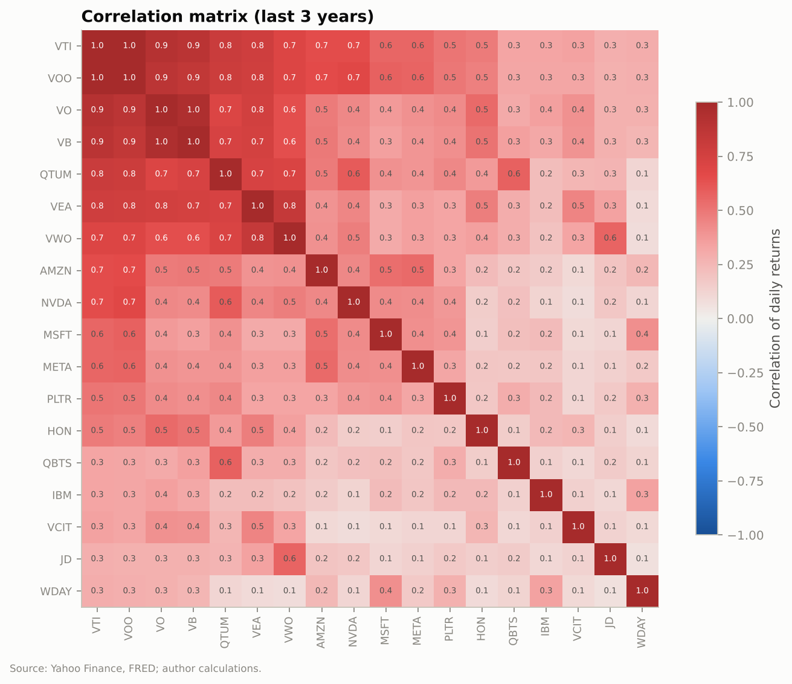

*Table 2.3 — Diversification (last 3 years)*

| Measure | Value | Meaning |
|---|---:|---|
| Average pairwise correlation | 0.38 | Holdings move together moderately |
| Diversification ratio | 1.65 | Portfolio volatility is 1/1.65 of the average holding's |
| Effective number of independent bets | **2.7** | 18 holdings behave like fewer than 3 independent ones |
| Most correlated pair | VOO / VTI, 0.996 | Practically the same fund |
| Least correlated pair | JD / WDAY, 0.07 | |

*Table 2.4 — Time-series tests* (tables: `p1_adf.md`, `p1_ljung_box.md`)

| Test | Result |
|---|---|
| ADF on log prices | **0 of 20** holdings stationary (p > 0.05 for all) |
| ADF on log returns | **20 of 20** stationary (p < 0.001) |
| Ljung-Box on returns, 10 lags | 15 of 18 show small but significant autocorrelation |
| Ljung-Box on squared returns | **18 of 18** show volatility clustering |

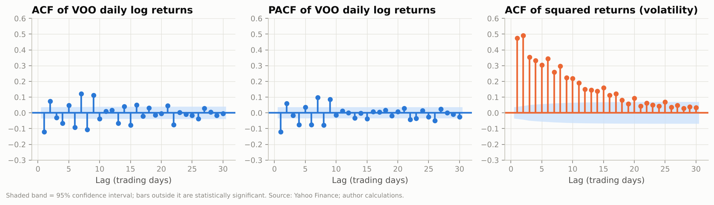

**Interpretation.**
1. **The portfolio beat the S&P 500 by a wide margin, mostly by taking more
   market risk.** It returned 23.7% a year against 14.8% since 2016, and 45.2%
   against 22.2% over the last 3 years. Its beta rose from 1.09 to 1.28 over
   the last 3 years, so it now behaves like a 1.3× leveraged index fund. That
   amplifies falls as well as gains: its worst drawdown (−36.5%) was deeper
   than the S&P's.
2. **A few names did most of the work.** QBTS, PLTR and NVDA together
   supplied about 18 of the portfolio's roughly 34 percentage points of
   annual return over the last 3 years. The result depends heavily on a small
   group of AI and quantum stocks continuing to do well.
3. **Volatility destroys compound returns.** QBTS has a positive Sharpe ratio
   over its full history (0.63), yet it compounded at only **0.6% a year**
   since its 2022 listing. With 146% volatility, its −96.7% drawdown needed
   roughly a 30× rebound just to break even. See the concept box below.
4. **There is less diversification than 18 holdings suggest.** The effective
   number of independent bets is only 2.7. VOO and VTI are 99.6% correlated,
   so holding both adds cost and complexity but no diversification. VCIT (the
   bond ETF) is the only holding that meaningfully cushions equity falls.
5. **The time-series facts match Shumway & Stoffer.** Prices wander
   (non-stationary) and returns don't, which is why every later model uses
   returns. Returns themselves are barely predictable from their own past (the
   ACF bars sit near zero). But **volatility is highly persistent**: the ACF of
   squared returns decays slowly over about 20 days. That is why Phase 4
   forecasts *risk* far more reliably than *returns*.

> **📘 Concept — volatility drag.** If a stock gains 50% and then loses 50%,
> its average return is 0%, but you are down 25% (1.5 × 0.5 = 0.75).
> Approximately, compound growth ≈ average return − ½ × volatility². At 146%
> volatility the drag is about 107 percentage points a year, enough to wipe
> out a very high average return.

**Caveats.** Equal weight is an assumption, not your actual allocation. The
3-year window excludes holdings with shorter histories (OKLO, SOLS) and the two
with unusable data (SKYT, PSKY). Ljung-Box tests use the full history, which
includes the 2020 crash, and crises inflate measured autocorrelation.

---

## 3. Phase 2 — Portfolio optimisation

**Objective.** Find the weights that would have given the best risk-adjusted
return, and test whether that advantage survives when weights are chosen
*without hindsight*.

**Method.**
- **A. In-sample (textbook):** estimate expected returns and the covariance
  matrix on the last 3 years; 10,000 random portfolios; exact max-Sharpe and
  min-volatility solutions (SLSQP solver); efficient frontier. Long-only, with
  at most 25% in any single holding.
- **B. Out-of-sample (realistic):** every month, re-optimise using only the
  trailing 3 years, hold for a month, and charge trading costs.
- Covariance uses **Ledoit-Wolf shrinkage**, which pulls extreme correlation
  estimates toward a sensible average.

> **📘 Concept — why the in-sample answer flatters itself.** The optimiser
> treats historical average returns as known truths. They are very noisy
> estimates (a 3-year average return has a standard error of about ±15–20 percentage points
> for a typical stock). It will over-weight whatever happened to do well. Part B
> measures how much of the promised improvement is real.

**Results.**

*Table 3.1 — In-sample (Nov 2023 – Nov 2026, 18 holdings, risk-free 4.4%)*

| Portfolio | Expected return | Volatility | Sharpe | Largest weight | Holdings > 1% |
|---|---:|---:|---:|---|---:|
| Current (equal weight) | 34.2% | 20.5% | 1.46 | 5.6% each | 18 |
| **Max Sharpe** | 61.2% | 31.3% | **1.81** | NVDA 25% | 6 |
| Min volatility | 14.8% | 11.0% | 0.95 | VCIT 25% | 9 |
| Best of 10,000 random | 50.5% | 26.6% | 1.73 | — | — |

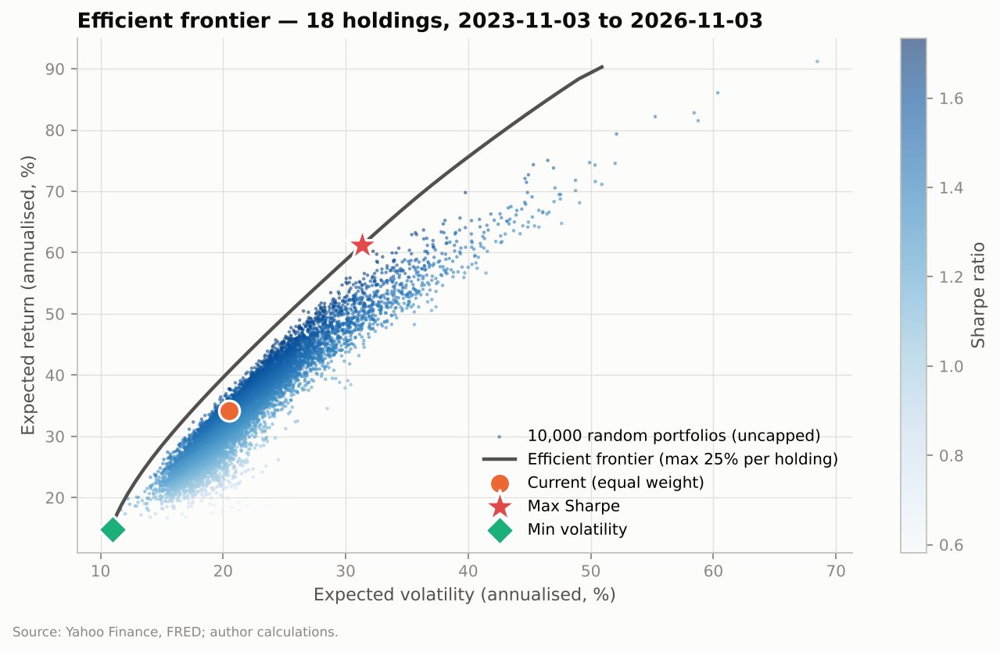
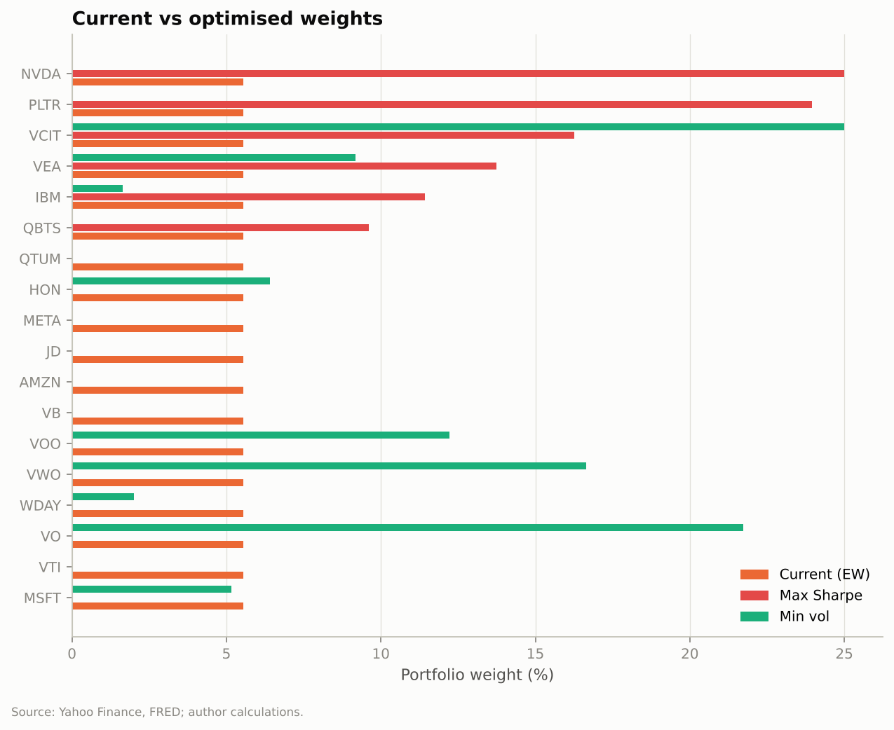

The max-Sharpe portfolio puts 25% in NVDA, 24% in PLTR, 16% in VCIT, 14% in
VEA, 11% in IBM and 10% in QBTS, and **zero** in the other 12 holdings.

*Table 3.2 — Out-of-sample: re-optimised every month using only the trailing 3 years (Feb 2018 – Nov 2026, net of costs)*

| Strategy | CAGR | Volatility | Sharpe | Max drawdown | Beta | Turnover / yr |
|---|---:|---:|---:|---:|---:|---:|
| **Equal weight** | **22.2%** | 23.8% | **0.85** | −36.5% | 1.09 | 39% |
| Max Sharpe (rolling) | 17.3% | 25.8% | 0.64 | −48.9% | 1.07 | 132% |
| Min vol (rolling) | 8.5% | 14.1% | 0.46 | −30.3% | 0.68 | 38% |
| VOO (S&P 500) | 13.7% | 19.1% | 0.63 | −34.0% | 1.00 | — |

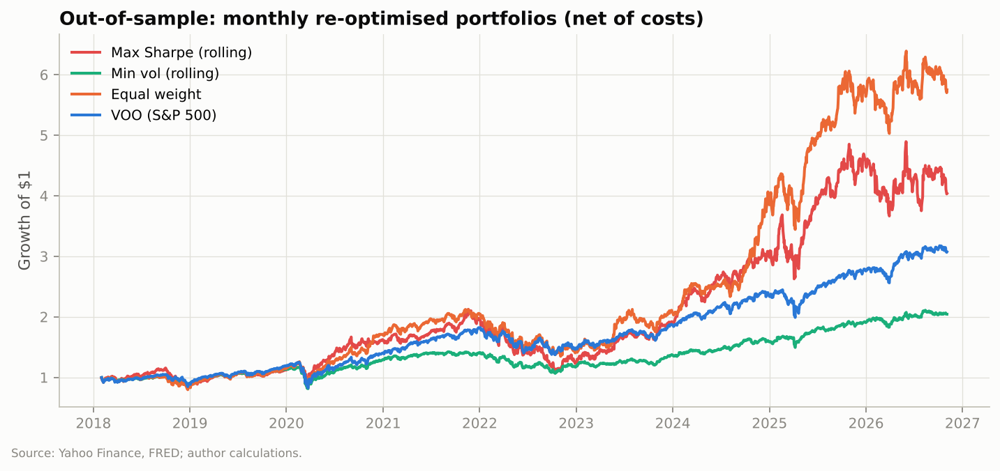

**Interpretation.**
1. **In hindsight, optimisation looks like a big win.** The Sharpe ratio rises
   from 1.46 to 1.81. The current portfolio sits well inside the frontier,
   i.e. the same return was available with less risk.
2. **Without hindsight, the win disappears.** Re-optimising every month on
   data available at the time produced a *lower* Sharpe ratio than simply
   holding equal weights (0.64 vs 0.85). It also had a deeper drawdown (−48.9%)
   and over three times the trading. The optimiser kept chasing whichever
   holdings had done best over the previous 3 years, just before many of them
   cooled off.
3. **Practical takeaway.** Raw mean-variance optimisation on historical
   averages should **not** be used to set the weights here. Equal weight is a
   tough, cheap benchmark (DeMiguel, Garlappi & Uppal, 2009 reach the same
   conclusion across many datasets). Phases 3–5 test whether better
   *forecasts* (instead of historical averages) can beat it.
4. Min-volatility does what it promises (lowest risk, smallest drawdown), but
   with a much lower return. It is an option only if lower risk is the
   priority.

---

## 4. Phase 3 — Signal research

**Objective.** Test whether any combination of free data predicts which
holdings will beat the portfolio average over the next 5 trading days.

**Method.**
- **25 features in 7 families:** momentum (1d–12m), oscillator (RSI), volatility,
  market-relative (beta, relative strength), volume, cross-sectional ranks,
  macro (VIX, term and credit spreads, rate changes). Definitions:
  [`src/pa/features.py`](../src/pa/features.py).
- **Target:** 5-day forward log return *minus the average holding's*. The
  question is which holdings to overweight, not where the market goes.
- **Models:** 12-1 momentum (no fitting; the baseline), AR(p) per asset
  (Shumway & Stoffer ch. 3), Ridge regression, XGBoost, LSTM, and a rank-average
  ensemble.
- **Walk-forward validation:** refit monthly on an expanding window. Training
  stops 5 days before each refit so no future returns leak in (purging). Two
  automated tests verify that changing future prices never changes any past
  prediction.

> **📘 Concept — the information coefficient (IC).** Each day, rank the
> holdings by the model's forecast and by what actually happened, then
> correlate the two rankings. IC = 0 is a coin flip; IC = 1 is perfect. In
> professional equity research **an IC of 0.02–0.05 that holds up out of sample
> is considered useful**, because small edges add up across many bets. We also
> report the **t-stat** (computed on non-overlapping 5-day periods; above ~2
> is unlikely to be luck) and the **hit rate** (share of correct
> beat-or-lag-the-average calls; 50% = no skill).

**Results — individual features** (validation period only, Jan 2016 – Oct 2025;
table `p3_feature_ic.md`)

*Table 4.1 — Strongest single features (mean daily rank IC vs the next 5-day relative return)*

| Feature | What it measures | IC | t-stat | IC 40 days later |
|---|---|---:|---:|---:|
| `mom_12_1` | 12-month return, skipping the latest month | **+0.047** | **2.53** | +0.044 |
| `vol_63` | 3-month volatility | +0.046 | 2.73 | +0.048 |
| `vol_21` | 1-month volatility | +0.039 | 2.25 | +0.048 |
| `beta_63` | 3-month beta to the S&P 500 | +0.038 | 2.01 | +0.051 |
| `idio_vol_63` | Volatility not explained by the market | +0.037 | 2.52 | +0.038 |
| `ma_gap_50_200` | 50-day vs 200-day moving average | +0.032 | 1.82 | +0.040 |
| `r_1` | Yesterday's return | −0.019 | −2.68 | +0.006 |
| `dollar_vol_trend` | Trading-value trend | −0.020 | −2.23 | +0.014 |

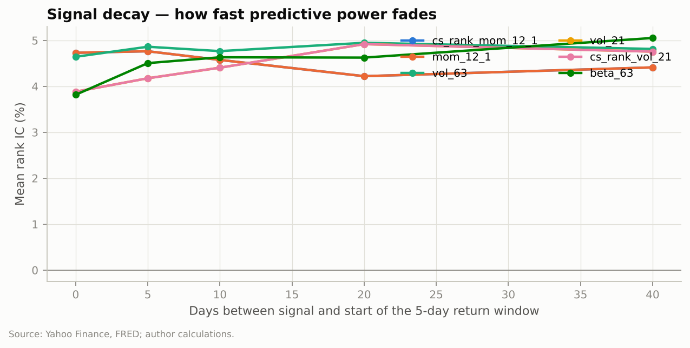

*Table 4.2 — Regime dependence (IC when VIX is below vs above its median)*

| Feature | Calm markets | Stressed markets |
|---|---:|---:|
| `mom_12_1` | **+0.075** | +0.019 |
| `vol_63` | +0.059 | +0.034 |
| `beta_63` | +0.040 | +0.037 |

**Results — models** (walk-forward; table `p3_model_scores.md`)

*Table 4.3 — Out-of-sample signal quality*

| Model | Validation IC | t-stat | Hit rate | Top-minus-bottom third (ann.) | **Hold-out IC** | Hold-out hit rate |
|---|---:|---:|---:|---:|---:|---:|
| **Momentum 12-1** (baseline, no fitting) | **+0.045** | **2.20** | **53.1%** | **+13.0%** | −0.008 | 49.9% |
| AR(p) per asset | +0.032 | 1.59 | 48.7% | +7.9% | −0.091 | 53.3% |
| Ridge regression | +0.018 | 0.58 | 50.4% | +12.0% | −0.066 | 46.7% |
| XGBoost | +0.011 | 0.69 | 50.7% | −1.1% | −0.053 | 43.7% |
| LSTM | +0.008 | 0.49 | 49.6% | −0.9% | +0.013 | 48.1% |
| Ensemble (Ridge + XGB + LSTM) | +0.015 | 0.51 | 49.0% | +7.9% | −0.041 | 53.5% |

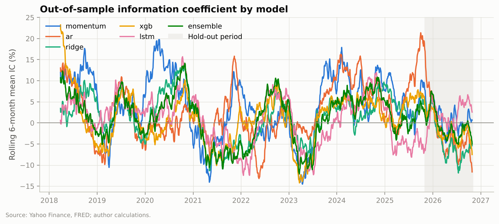
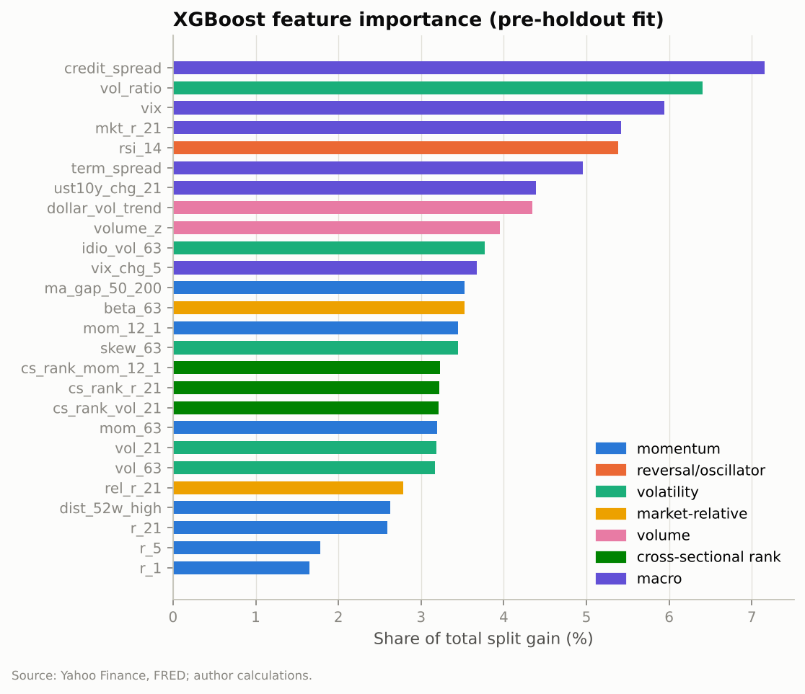

**Interpretation.**
1. **Momentum is the only signal that clears the bar.** An IC of 0.045 with a
   t-stat above 2 is in the "useful" range used by professional researchers. It
   also decays slowly (still 0.044 forty days later), so it suits weekly or
   monthly rebalancing without heavy trading.
2. **"Riskier holdings did better" is a regime effect, not a law.** High
   volatility and high beta predicted outperformance because 2016–2025 was a
   long bull market led by volatile tech names. In a sustained bear market, the
   same feature would likely flip sign. Momentum is also strongest in calm
   markets (IC 0.075) and weak in stressed ones (0.019), consistent with the
   well-documented "momentum crash" risk.
3. **More complex models did worse, not better.** None of Ridge, XGBoost, LSTM
   or the ensemble beat the zero-parameter momentum rule. The XGBoost
   importance chart explains much of it: its top features are **macro
   variables** (credit spread, VIX, term spread). Those take the same value for
   every holding on a given day, so they cannot help *rank* holdings. The
   model is using them to fit noise. Removing or interacting them is the first
   target for the improvement loop (§7).
4. **In the hold-out year, nothing worked.** Every signal's IC was near zero or
   negative from Nov 2025 to Nov 2026. That year was dominated by a sharp
   reversal in the previous winners (OKLO −82%, QBTS −72%), exactly the
   environment in which momentum struggles. This is why the hold-out exists:
   validation results alone would have overstated the edge.

> **📘 Concept — why simple often beats complex in finance.** Market data is
> extremely noisy: a 5-day return is mostly luck. A flexible model (thousands
> of tree splits, an LSTM's thousands of weights) can fit that luck perfectly
> in training and then fail on new data. That is *overfitting*. A one-number
> rule like momentum can't overfit, so it often generalises better.

**Caveats.** With 20 usable holdings, the daily cross-section is small, so ICs are
noisy. That is why t-stats and the hold-out matter more than any single number.
Free data excludes the options, news-sentiment and short-interest features
originally planned with WRDS, LSEG and Bloomberg (§9).

---

## 5. Phase 4 — Risk management and position sizing

**Objective.** Turn forecasts into position sizes that survive trading costs
and bad periods.

**Method** (weekly rebalance; strategies compared on the same dates):
1. **Signal tilt:** start at equal weight; overweight holdings the model
   likes, underweight ones it dislikes (w ∝ 1 + 0.5·z-score).
2. **Volatility targeting:** scale total exposure so predicted portfolio
   volatility is 15%, using an exponentially weighted covariance matrix (recent
   data counts more). The rest sits in T-bills.
3. **Drawdown stop:** if the portfolio is down more than 20% from its peak,
   halve risk until the loss recovers to 10%.
4. **Half-Kelly sizing** as an alternative to (1).
5. Costs: see §1.2. Sensitivity at 0×, 1×, 2× and 4× costs.

> **📘 Concept — the Kelly criterion.** Kelly sizing grows wealth fastest *if
> you know your true edge*. You never do, and over-betting is far worse than
> under-betting. Practitioners therefore bet a fraction: **half-Kelly** keeps
> about ¾ of the growth with about ½ the volatility.

**Results** (signal = momentum, the best validation model; Feb 2018 – Nov 2026;
table `p4_strategy_comparison.md`)

*Table 5.1 — Strategy comparison, net of trading costs*

| Strategy | CAGR | Volatility | Sharpe | Max drawdown | Beta | Hold-out Sharpe | Turnover / yr | Avg invested |
|---|---:|---:|---:|---:|---:|---:|---:|---:|
| Equal weight (current) | 22.2% | 23.8% | 0.85 | −36.5% | 1.09 | −0.29 | 39% | 100% |
| **Momentum tilt** | **24.1%** | 25.5% | **0.87** | −36.9% | 1.14 | −0.49 | 178% | 100% |
| Tilt + vol target + DD stop | 12.3% | 14.7% | 0.68 | **−23.5%** | 0.62 | −0.60 | 143% | 62% |
| Half-Kelly + vol target + DD stop | 9.2% | 14.7% | 0.49 | −22.8% | 0.63 | −0.02 | 567% | 72% |
| EW + vol target + DD stop | 9.0% | 14.6% | 0.48 | −22.5% | 0.61 | −0.49 | 74% | 67% |
| VOO (S&P 500) | 13.7% | 19.1% | 0.63 | −34.0% | 1.00 | **+0.65** | — | 100% |

*Table 5.2 — Cost sensitivity (tilt + vol target + DD stop)*

| Trading costs | 0× | 1× (base) | 2× | 4× |
|---|---:|---:|---:|---:|
| Sharpe | 0.73 | 0.72 | 0.71 | 0.69 |
| CAGR | 13.2% | 13.0% | 12.9% | 12.4% |

*(The cost-sensitivity run starts at the first rebalance with a full
covariance history, so its base figures differ slightly from Table 5.1.)*

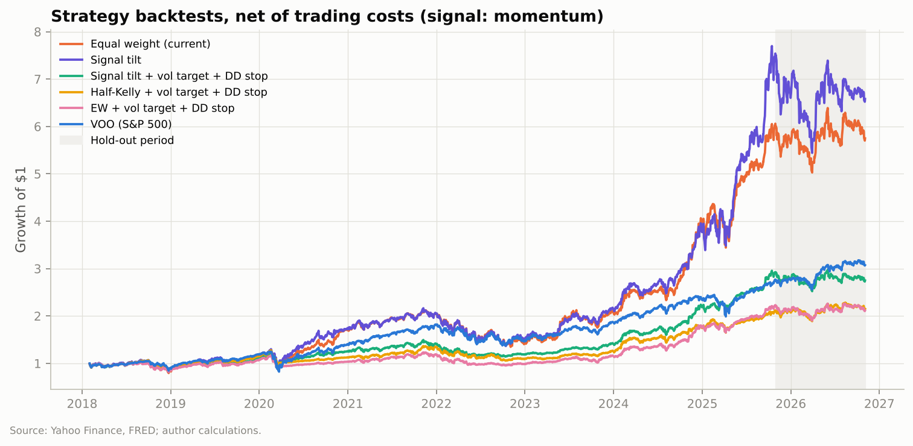
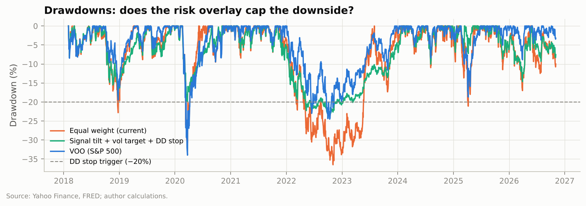

**Interpretation.**
1. **The momentum tilt adds a little, at a cost in trading.** It raised return
   by 1.9 points a year with almost the same risk (Sharpe 0.87 vs 0.85), but
   traded 4.5× more. The improvement is small enough that it could be luck, and
   it reversed in the hold-out year.
2. **Volatility targeting worked as a seatbelt, not an engine.** It cut the
   worst drawdown by a third (−36.5% → −23.5%) and halved beta. It also sat
   partly in cash during sharp rebounds (2020, 2023), so it gave up more
   return than it saved. It suits an investor whose priority is limiting losses.
3. **Kelly sizing is fragile when the edge is small.** With an IC of 0.045, the
   estimated "edge" per holding is tiny and noisy, so Kelly weights swung
   wildly (567% turnover) for the lowest Sharpe of any strategy.
4. **Costs are not the bottleneck.** Quadrupling trading costs lowers the
   Sharpe ratio by only 0.03. The limit is the weakness of the signal itself.

**Caveats.** The drawdown stop's 20% trigger and the 15% volatility target are
round-number choices, not optimised. Optimising them on this same history
would overfit.

---

## 6. Phase 5 — Black-Litterman with model views

**Objective.** Combine a neutral starting point with the model's views, in
proportion to how much the model has earned trust.

**Method.**
- **Prior:** the returns that would make the reference weights optimal
  (π = δΣw, δ = 2.5). The backtest uses equal weight as the reference, so no
  look-ahead from current market caps. Today's recommendation also shows the
  market-cap/AUM prior from Bigdata.com.
- **Views:** Grinold's rule α = IC × volatility × forecast z-score, using the
  model's **own trailing 1-year realised IC**. If the model has had no skill
  lately, α ≈ 0 and the allocation stays at the prior.
- **Blend** with τ = 0.05; Ω proportional to τΣ; mean-variance weights capped
  at 25% per holding.

> **📘 Concept — Black-Litterman in one sentence.** Start from "the market
> knows best", then tilt only as far as your evidence justifies. That avoids
> the extreme, unstable weights in Phase 2.

**Results.**

*Table 6.1 — Backtest, monthly rebalance, net of costs (Feb 2019 – Nov 2026)*

| Strategy | CAGR | Volatility | Sharpe | Max drawdown | Info ratio | Hold-out Sharpe |
|---|---:|---:|---:|---:|---:|---:|
| Equal weight (current) | 26.3% | 24.2% | **0.97** | −36.5% | 0.79 | −0.29 |
| Black-Litterman (momentum views) | 25.2% | 24.1% | 0.94 | −36.4% | 0.70 | −0.51 |
| Max Sharpe on historical means | 26.3% | 26.5% | 0.91 | −38.0% | 0.58 | −0.47 |
| VOO (S&P 500) | 16.0% | 19.3% | 0.72 | −34.0% | — | +0.65 |

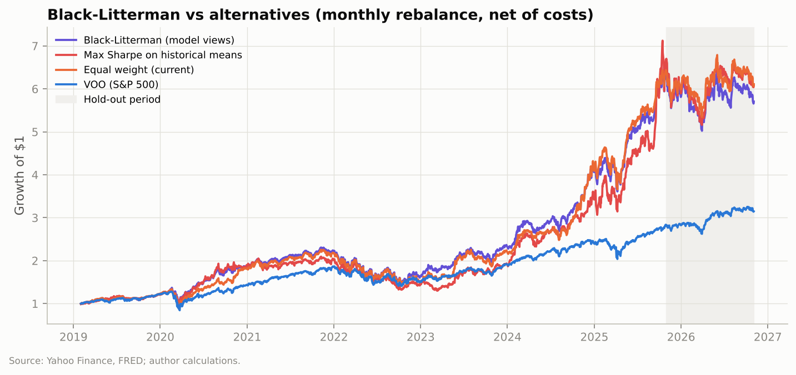

*Table 6.2 — Allocation as of 3 Nov 2026* (full table: `p5_recommendation.md`)

| Holding | Current (EW) | Market-cap prior | BL weight, market-cap prior | BL weight, EW prior | Analyst upside |
|---|---:|---:|---:|---:|---:|
| NVDA | 5.3% | 31.1% | 25.0% (cap) | 5.2% | +62.6% |
| MSFT | 5.3% | 24.1% | 24.2% | 5.3% | +18.5% |
| AMZN | 5.3% | 16.9% | 16.2% | 5.2% | +32.5% |
| VOO | 5.3% | 6.4% | 9.1% | 5.5% | — |
| META | 5.3% | 8.6% | 8.9% | 5.2% | +34.3% |
| VTI | 5.3% | 4.4% | 6.5% | 5.5% | — |
| PLTR | 5.3% | 2.6% | 2.9% | 5.2% | +25.1% |
| VWO | 5.3% | 0.8% | 2.3% | 5.4% | — |
| QTUM | 5.3% | <0.1% | 1.8% | 5.3% | — |
| QBTS | 5.3% | <0.1% | 0.0% | 5.2% | +250% |
| OKLO | 5.3% | <0.1% | 0.3% | 5.2% | +173% |
| *Other 8 holdings* | 42.1% | 4.9% | 2.8% | 42.0% | |

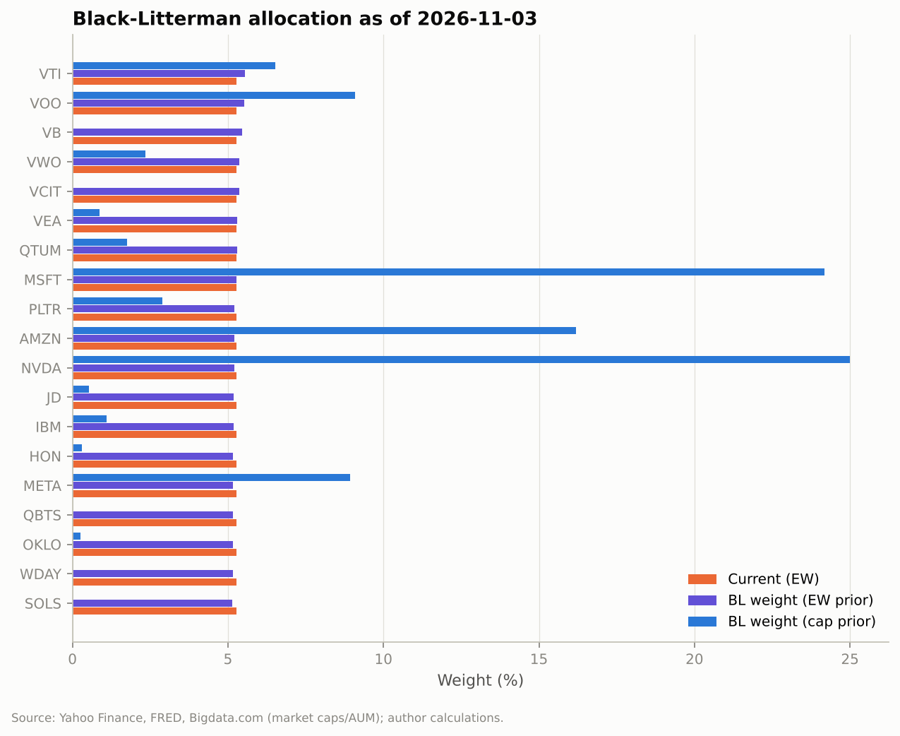

**Interpretation.**
1. **The safety valve works.** The model's views are scaled by momentum's
   *own* realised accuracy over the past year, which is currently slightly
   negative (IC −0.013). Black-Litterman therefore adds **no tilt today**: the
   allocation stays at whichever starting point is chosen.
2. **Black-Litterman did not beat equal weight in the backtest** (Sharpe 0.94
   vs 0.97). That is consistent with Phase 3: the views are only as good as the
   signal, and the signal is weak.
3. **The choice of starting point matters far more than the views.** A
   market-cap starting point concentrates **74% in NVDA, MSFT, AMZN and
   META** and almost nothing in the speculative names. It is the most
   "market-like" option, and it would have avoided most of the hold-out-year
   losses. Equal weight spreads risk across holdings far more evenly, at the
   price of large exposure to small, volatile companies.
4. Analyst price targets (shown only as a cross-check) are most bullish on the
   names the market has punished most (QBTS +250%, OKLO +173%). Treat targets
   on highly volatile stocks with caution: they are updated slowly and cluster
   optimistically.

---

## 7. Model governance and the self-improvement loop

| Control | Implementation |
|---|---|
| No look-ahead | Purged walk-forward; tests `test_features_have_no_lookahead`, `test_walk_forward_has_no_lookahead` |
| Hold-out discipline | Data from 2025-11-01 is never used for selection; it is reported at every check-in |
| Promotion rule | A challenger replaces the champion only if validation ICIR (IC information ratio: average IC divided by its volatility, annualised) improves by ≥ 0.05 |
| Multiple-testing awareness | Every experiment is logged in `results/metrics/scoreboard.jsonl`; total count reported at each check-in |
| Reproducibility | Fixed seeds; `run_all.sh`; parameters in `config.py` |

**Starting champion:** 12-1 momentum (validation ICIR 0.78, IC 0.045). The
learned models must beat it by ≥ 0.05 ICIR to replace it.

**Check-in log** (`results/metrics/checkins.md`). An entry is appended
automatically whenever the champion model improves. *No promotions yet.*

---

## 8. Limitations and disclosures

- **Educational research, not investment advice.** Backtests are hypothetical
  and benefit from hindsight in the choice of holdings (survivorship bias:
  today's holdings were chosen knowing they still exist).
- Equal-weight assumption (§1.2); trading costs are estimates; no taxes.
- Several holdings have short histories (OKLO since its May 2024 merger, SOLS
  since Oct 2025), which limits what can be estimated for them. SKYT and PSKY
  are excluded because their free data is broken.
- The 2016–2025 sample is dominated by a tech-led bull market. Signals that
  worked in it (momentum, high-beta) may behave differently in other regimes.
- Free data only. Options-implied volatility, professional news sentiment and
  short interest were not available (§9).

## 9. Changes from the original plan

| Original (README) | Now | Reason |
|---|---|---|
| WRDS/OptionMetrics, LSEG news, Bloomberg, Capital IQ | Yahoo Finance, FRED, Bigdata.com snapshot | Institutional access ended at graduation |
| Options & sentiment features | Price/volume/macro features; sentiment snapshot as a cross-check only | Free historical sentiment/options data is not available |
| Jupyter notebooks | Python pipelines + this report (charts in `results/figures`) | Reproducible end to end, testable, and runnable by the automated improvement loop |

## Glossary

**Basis point (bp):** 0.01%. **Covariance matrix:** how every pair of holdings
moves together. **Efficient frontier:** the best possible return for each level
of risk. **Ledoit-Wolf shrinkage:** blending a noisy estimate toward a simple,
stable one. **Look-ahead bias:** accidentally using information that was not
yet known at decision time. **Turnover:** share of the portfolio traded per year
(100% = the whole portfolio replaced once). **Walk-forward:** repeatedly
train on the past and test on the period just after it, like trading in real
time.

## References

Black & Litterman (1992), *FAJ*; DeMiguel, Garlappi & Uppal (2009), *Review of Financial Studies*; Grinold & Kahn (2000), *Active Portfolio
Management*; He & Litterman (1999); Ledoit & Wolf (2004), *J. Multivariate
Analysis*; López de Prado (2018), *Advances in Financial Machine Learning*;
Markowitz (1952), *J. Finance*; Shumway & Stoffer (2017), *Time Series
Analysis and Its Applications*; Chen & Guestrin (2016), *KDD*; Hochreiter &
Schmidhuber (1997), *Neural Computation*.

*Market snapshot data from [Bigdata.com](https://bigdata.com) (underlying
providers include FMP).*
